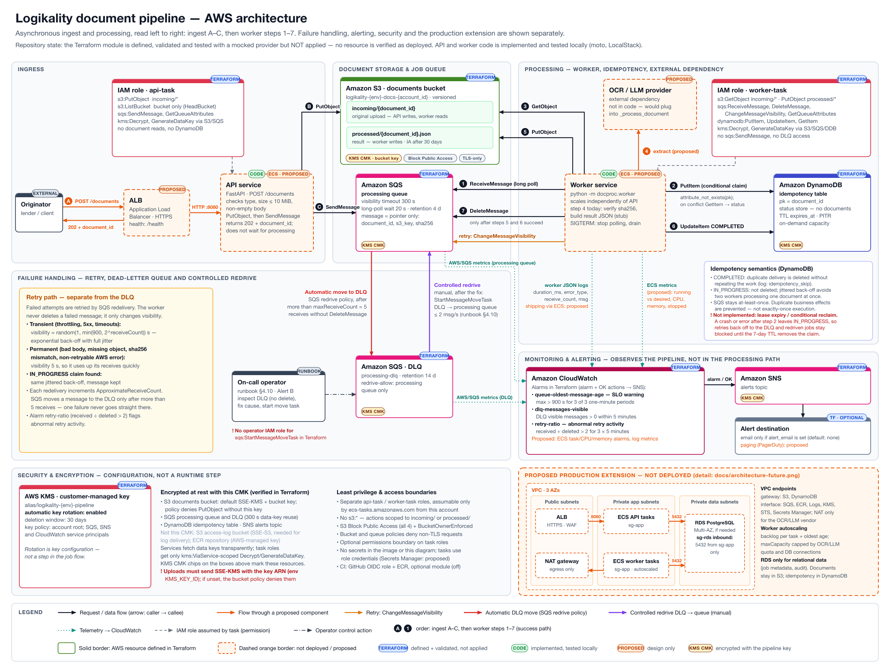

# Logikality document pipeline

Practical assessment: a minimal HTTP service that accepts mortgage documents, stores them in S3, and processes them asynchronously from SQS. Infrastructure is Terraform (validated, tested, scanned — **not applied**). CI/CD is GitHub Actions. SRE response is in [`incident-runbook.md`](incident-runbook.md).

You are not expected to spend money. Everything that can run, runs locally (pytest + moto, `terraform test` with a mocked AWS provider, Docker, optional LocalStack).

## Deliverables checklist

| Requirement | Location |
| --- | --- |
| Application source | [`app/`](app/) |
| Dockerfile | [`Dockerfile`](Dockerfile) |
| Evidence the image builds and runs | [`docs/evidence/docker-build.txt`](docs/evidence/docker-build.txt), [`docs/evidence/docker-run.txt`](docs/evidence/docker-run.txt) |
| Terraform | [`infra/`](infra/) |
| CI/CD | [`.github/workflows/`](.github/workflows/) |
| Architecture diagram | [`architecture.png`](architecture.png) |
| Incident runbook | [`incident-runbook.md`](incident-runbook.md) |
| This README | [`README.md`](README.md) |

## Architecture



The diagram reads left to right. Ingest is steps A–C: the API stores the document in S3, enqueues a pointer message, and returns `202`. The worker then runs steps 1–7: receive, conditional DynamoDB claim, `GetObject`, process, `PutObject processed/`, mark `COMPLETED`, and finally `DeleteMessage`. Retries, the automatic DLQ move, controlled redrive, alerting, security and the production extension each have their own area, so they don't cross the success path.

| Scope | Components |
| --- | --- |
| Defined in Terraform (validated, **not applied**) | S3 documents bucket (`incoming/`, `processed/`), SQS processing queue + DLQ, DynamoDB idempotency table, KMS CMK (rotation on), `api-task` / `worker-task` IAM roles, 3 CloudWatch alarms, SNS topic (email only if `alert_email` is set). Optional, off by default: GitHub OIDC role + ECR. |
| Implemented in code, tested locally (moto, LocalStack) | FastAPI API (`POST /documents`, `/health`, `/ready`), SQS worker with DynamoDB claims, back-off with jitter, and error classification. |
| Proposed — not deployed | ALB, ECS services, OCR/LLM provider, ECS and application-metric alarms, paging, VPC, VPC endpoints, NAT, RDS, worker autoscaling. |
| Verified as deployed | None. `terraform plan` was not run against an account ([`docs/evidence/tf-plan.txt`](docs/evidence/tf-plan.txt)). |

Editable sources: [`docs/diagrams/architecture.py`](docs/diagrams/architecture.py) and [`docs/diagrams/architecture-future.py`](docs/diagrams/architecture-future.py). These are standard-library Python scripts that write SVG next to themselves; `make diagram` re-renders both PNGs with `rsvg-convert`.

**Known gaps the diagram makes visible** (documented, not yet fixed):

- **Stale idempotency claims.** `IdempotencyStore.claim` has no lease expiry and no conditional reclaim, and nothing clears the `IN_PROGRESS` claim when processing fails. A crash or error after the claim therefore makes every retry return `in_progress` and back off. The job ends up in the DLQ, and a redriven job stays blocked until the 7-day TTL deletes the claim.
- **SSE-KMS header on uploads.** The bucket policy denies `PutObject` unless the request names the pipeline key ARN. The app only sends that header when `KMS_KEY_ID` is set, so a deployed task must set `KMS_KEY_ID` to the key ARN.
- **DLQ redrive permissions.** The runbook's `start-message-move-task` needs an operator role with SQS move-task permissions, and Terraform does not define one.

How we would add compute, RDS and production networking: [`docs/architecture-extension.md`](docs/architecture-extension.md). Production-target diagram (proposed, not deployed): [`docs/architecture-future.png`](docs/architecture-future.png).

## Repository layout

```
app/                 FastAPI API + SQS worker, tests
Dockerfile           multi-stage, non-root, HEALTHCHECK
docker-compose.yml   api + worker + LocalStack
infra/               Terraform root + modules
.github/workflows/   ci, terraform, security, deploy (gated)
incident-runbook.md  production troubleshooting
docs/                design, security, evidence
scripts/             e2e, backlog simulation, evidence collector
```

## Prerequisites

- Docker
- Python 3.12 (this repo uses a venv at `app/.venv`)
- Terraform >= 1.11 (`brew tap hashicorp/tap && brew install hashicorp/tap/terraform`)
- Optional: `tflint`, `hadolint`, `actionlint`, `trivy`, `gitleaks`, `checkov`, `librsvg` (`rsvg-convert`, for `make diagram`)

```bash
make install          # uv pip into app/.venv
```

## Quickstart

```bash
make test             # pytest + coverage >= 90%
make lint             # ruff + mypy (src strict, tests)
make docker-build
make docker-run
make smoke            # curl / and /health
make tf-validate
make tf-test
make tf-scan          # checkov
make e2e              # LocalStack: POST a document, wait for processed/, replay for idempotency
```

Local compose publishes the API on **http://127.0.0.1:18080** (container port 8080) so it does not collide with other local services.

Standalone container (no AWS): `GET /` and `GET /health` work; `GET /ready` returns `disabled`; `POST /documents` returns 503.

## AWS credentials

The Terraform AWS provider **does not hardcode a profile**. That way the same code works for every operator and for GitHub OIDC.

```bash
# Prefer SSO
aws configure sso --profile <your-profile>
# or, dev-only static keys (never commit them)
aws configure --profile <your-profile>

aws sts get-caller-identity --profile <your-profile>

export AWS_PROFILE=<your-profile>
cd infra
terraform init -backend=false
terraform plan          # allowed. Do not apply unless you intend to spend.
```

Never commit `~/.aws`, `*.tfvars`, or access keys. `*.tfvars.example` is safe.

## Validation and evidence index

Collected by `make evidence` → [`docs/evidence/`](docs/evidence/).

| Check | Evidence |
| --- | --- |
| pytest + coverage | [`docs/evidence/pytest.txt`](docs/evidence/pytest.txt) |
| ruff | [`docs/evidence/ruff.txt`](docs/evidence/ruff.txt) |
| mypy | [`docs/evidence/mypy.txt`](docs/evidence/mypy.txt) |
| hadolint | [`docs/evidence/hadolint.txt`](docs/evidence/hadolint.txt) |
| docker build + image size | [`docs/evidence/docker-build.txt`](docs/evidence/docker-build.txt) |
| docker run `/` `/health` | [`docs/evidence/docker-run.txt`](docs/evidence/docker-run.txt) |
| trivy image | [`docs/evidence/trivy-image.txt`](docs/evidence/trivy-image.txt) |
| e2e LocalStack | [`docs/evidence/e2e.txt`](docs/evidence/e2e.txt) |
| terraform fmt / validate | [`docs/evidence/tf-fmt.txt`](docs/evidence/tf-fmt.txt), [`docs/evidence/tf-validate.txt`](docs/evidence/tf-validate.txt) |
| tflint | [`docs/evidence/tflint.txt`](docs/evidence/tflint.txt) |
| checkov | [`docs/evidence/checkov.txt`](docs/evidence/checkov.txt) |
| terraform test | [`docs/evidence/tf-test.txt`](docs/evidence/tf-test.txt) |
| actionlint | [`docs/evidence/actionlint.txt`](docs/evidence/actionlint.txt) |
| backlog simulation | [`docs/evidence/backlog-simulation.txt`](docs/evidence/backlog-simulation.txt) |
| terraform plan (optional) | [`docs/evidence/tf-plan.txt`](docs/evidence/tf-plan.txt) — generated only when `AWS_PROFILE` is set |
| gitleaks | [`docs/evidence/gitleaks.txt`](docs/evidence/gitleaks.txt) |
| secret grep | [`docs/evidence/secret-grep.txt`](docs/evidence/secret-grep.txt) |

## Design decisions (short)

Full table: [`docs/design-decisions.md`](docs/design-decisions.md).

- **Python/FastAPI** — tests, typing, boto3, small team.
- **Liveness vs readiness** — `/health` never calls AWS so a queue outage cannot restart-loop the API. `/ready` probes S3 + SQS.
- **Split IAM roles** — API can `PutObject incoming/*` + `SendMessage`; worker can `GetObject incoming/*`, `PutObject processed/*`, consume the queue, and write DynamoDB. No `s3:*`.
- **CMK + S3 bucket keys** — control and rotation; bucket keys and SQS data-key reuse cut KMS cost (relevant to the "costs rising" incident).
- **Long polling 20s + DLQ maxReceiveCount=5 + visibility 300s**.
- **Lease-based DynamoDB idempotency** — claim is a visibility-timeout lease plus `release()` on errors, so a crash cannot strand a document as `IN_PROGRESS`.
- **Fargate next**, not Lambda (15-minute cap / large docs) and not EKS (ops cost).
- **Image tag `sha-<7>`**, never deploy `latest`. OIDC, not access keys.
- **`KMS_KEY_ID` is optional** — default bucket encryption applies SSE-KMS; the app only sends encryption headers when the key id is set.

## Review highlights

- Lease-based idempotency with reclaim of expired leases and `DeleteItem` on worker errors.
- CI **scans before it pushes**: load `docproc:scan`, smoke, Trivy, then a cache-hit push on non-PR events.
- Digest-pinned `python:3.12-slim` runtime; hashed `requirements.lock`; pip/setuptools stripped from the image.
- Sample ECS task definition at [`deploy/task-definition.json`](deploy/task-definition.json).

## Security

See [`docs/security.md`](docs/security.md) for the threat model, IAM reasoning, and justified Checkov skips.

## CI/CD

- [`ci.yml`](.github/workflows/ci.yml) — lint, test, **scan-before-push** (load → smoke → Trivy → push on `main`/`v*` with provenance + SBOM).
- [`terraform.yml`](.github/workflows/terraform.yml) — fmt, validate, `terraform test`, tflint, checkov.
- [`security.yml`](.github/workflows/security.yml) — gitleaks + Trivy filesystem, weekly schedule.
- [`deploy.yml`](.github/workflows/deploy.yml) — **disabled** until `vars.DEPLOY_ENABLED=true`. OIDC, promote by digest, smoke `/ready`, rollback previous task definition on failure.

How we would extend this to AWS and handle failed deploys: [`docs/deployment-and-rollback.md`](docs/deployment-and-rollback.md).

## Assumptions

- Single region (`us-east-1`, a variable).
- Documents are PII (`DataClassification=confidential`).
- SQS is at-least-once. DynamoDB claims plus deterministic S3 result keys prevent duplicate business effects; they do not make execution exactly-once.
- No live `terraform apply`, per the brief.
- Worker "processing" is a stub (hash, write `processed/{id}.json`). Real OCR/LLM would plug into `_process_document`.

## Limitations / what remains

- Infrastructure is not applied to AWS. `terraform plan` with `AWS_PROFILE=<your-profile>` is optional once credentials exist.
- Compute, RDS and VPC are documented, not coded ([`docs/architecture-extension.md`](docs/architecture-extension.md)).
- Document processing is a stub.
- The API has no authentication. Production: Cognito/JWT at the ALB or API Gateway.
- Remote state is an example file (`infra/backend.tf.example`).
- GitHub Actions are pinned to major tags, not commit SHAs (Dependabot is the update path; SHA pinning is the hardening step).
- `gitleaks-action` may require a license on GitHub orgs; local `gitleaks detect` is the evidence we always have.

## Follow-up discussion topics

- Why `/health` must not call SQS.
- Why we split API and worker roles instead of one task role.
- How bucket keys and long polling change the cost graph during a retry storm.
- Fargate vs Lambda for mortgage OCR.
- How we would prove the runbook with the LocalStack backlog simulation.

## License

Assessment submission — not for production use without the controls in `docs/architecture-extension.md`.
