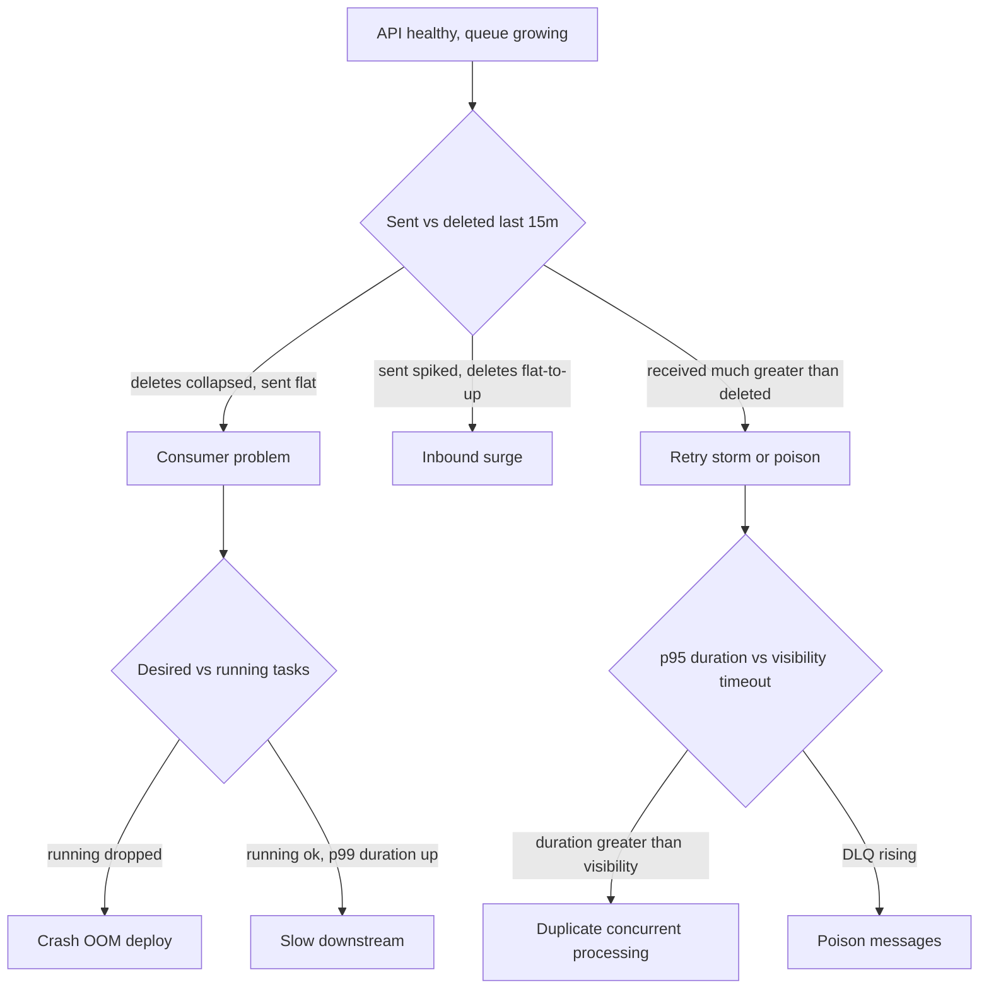

# Incident runbook: queue backlog / rising processing latency / retry storm

| Field | Value |
| --- | --- |
| Service | `docproc` (API + SQS worker) |
| Owner | Founding DevOps / on-call |
| Last exercised | LocalStack simulation — [`docs/evidence/backlog-simulation.txt`](docs/evidence/backlog-simulation.txt) (`scripts/simulate-backlog.sh`) |
| Related alarms | `queue-oldest-message-age`, `dlq-messages-visible`, `retry-ratio` (see `infra/modules/document-pipeline/alarms.tf`) |
| Customer-facing SLO | 99% of documents processed within **30 minutes** of ingest (`ApproximateAgeOfOldestMessage` < 1800s). Page at **900s** to give a 15-minute investigation window. |

## Severity

| Sev | Criteria | Response |
| --- | --- | --- |
| SEV1 | Age > 30 min **and** new originations blocked, or data-loss risk (never purge) | War room, 15-min updates, exec page |
| SEV2 | `ApproximateAgeOfOldestMessage` > 900s for 3 minutes, or retry-ratio > 2 for 15 min | Page on-call, 30-min updates |
| SEV3 | DLQ depth > 0, or worker CPU/memory elevated without SLO breach | Ticket, business hours |

**Roles:** Incident Commander (decides mitigations), Ops (runs CLI / dashboards), Comms (originator / internal status). Cadence: SEV2 every 30 minutes until age is falling.

---

## 1. Symptoms and hypothesis tree

The API is healthy (`/health` 200) but jobs accumulate, latency climbs, some messages retry, cloud cost rises. The API being healthy **rules out** "the service is down". It does **not** rule out a worker, downstream, or poison-message problem.



Canonical causes:

1. **Consumer throughput dropped** — workers crashed, OOMKilled, scaled in, failed a deploy, or are throttled.
2. **Per-message work got slower** — OCR/LLM 429s, S3 first-byte latency, DynamoDB throttling, larger documents.
3. **Poison messages / retry storm** — the same bodies are received over and over (`NumberOfMessagesReceived / NumberOfMessagesDeleted ≫ 1`).
4. **Visibility timeout shorter than processing** — SQS re-delivers a still-in-flight message; two workers process one document. Idempotency should skip the duplicate (`idempotency_skip` in logs) but both still consume compute and downstream quota.
5. **Inbound surge** — a batch import; arrivals exceed max worker capacity.

---

## 2. First 10 minutes: metrics, logs, components

Copy-paste. Replace `QUEUE_URL`, `CLUSTER`, `LOG_GROUP`.

### 2.1 SQS (source of truth for customer impact)

| Metric | Reads as |
| --- | --- |
| `ApproximateNumberOfMessagesVisible` | Backlog. |
| `ApproximateAgeOfOldestMessage` | **Customer impact.** This is the SLO signal. |
| `ApproximateNumberOfMessagesNotVisible` | In flight. High + low deletes = stuck / slow workers. |
| `NumberOfMessagesSent` vs `Received` vs `Deleted` | Receives/deletes > 1 ⇒ retries. |
| `NumberOfEmptyReceives` | Cost signal (should be near 0 with 20s long poll). |
| DLQ `ApproximateNumberOfMessagesVisible` | Poison or exhausted retries. |

```bash
QUEUE_URL=$(terraform -chdir=infra output -raw processing_queue_url)
aws sqs get-queue-attributes --queue-url "$QUEUE_URL" --attribute-names All
aws cloudwatch get-metric-statistics --namespace AWS/SQS \
  --metric-name ApproximateAgeOfOldestMessage \
  --dimensions Name=QueueName,Value=logikality-dev-processing \
  --start-time "$(date -u -d '30 minutes ago' +%Y-%m-%dT%H:%M:%SZ 2>/dev/null || date -u -v-30M +%Y-%m-%dT%H:%M:%SZ)" \
  --end-time "$(date -u +%Y-%m-%dT%H:%M:%SZ)" \
  --period 60 --statistics Maximum
```

### 2.2 Workers (ECS)

```bash
aws ecs describe-services --cluster logikality --services docproc-worker
aws ecs list-tasks --cluster logikality --service-name docproc-worker --desired-status STOPPED
# pick a stopped task
aws ecs describe-tasks --cluster logikality --tasks <task-arn> \
  --query 'tasks[].{stop:stoppedReason,exit:containers[].{reason:reason,oom:reason,code:exitCode}}'
aws application-autoscaling describe-scaling-activities \
  --service-namespace ecs --resource-id service/logikality/docproc-worker
```

Look for: running << desired, `OutOfMemoryError`, recent failed deployment, autoscaling already at `maxCapacity`.

### 2.3 Logs (CloudWatch Logs Insights)

Our worker emits JSON with `ts`, `level`, `msg`, `document_id`, `receive_count`, `duration_ms`, `error_type`.

**Error rate by type (15m):**

```
fields @timestamp, error_type, msg
| filter logger = "docproc.worker" and level = "ERROR"
| stats count() by error_type
```

**p50/p95/p99 processing time:**

```
fields duration_ms
| filter msg = "processed"
| stats pct(duration_ms, 50), pct(duration_ms, 95), pct(duration_ms, 99)
```

**Poison suspects (high receive_count):**

```
fields document_id, receive_count, msg
| filter ispresent(receive_count) and receive_count > 2
| stats max(receive_count) as max_rc, count() as hits by document_id
| sort max_rc desc
| limit 20
```

**Duplicate processing (idempotency working):**

```
filter msg = "idempotency_skip" or msg = "idempotency_in_progress"
| stats count() by msg
```

### 2.4 Downstreams

- OCR/LLM vendor: latency, 429, 5xx, remaining quota. 429s with no `Retry-After` honouring are the #1 retry-storm trigger.
- S3 `5xxErrors`, `FirstByteLatency` on the document bucket.
- DynamoDB `ThrottledRequests`, `SuccessfulRequestLatency` on the idempotency table.
- KMS `ThrottlingException` in CloudTrail (bucket keys should keep this rare; a retry storm will still show up).
- Future RDS: CPU, connections, `lock_timeout`, `deadlocks`.

### 2.5 Cost (why the bill moves with the backlog)

Every retry re-pays:

- Fargate vCPU-hours
- SQS request units (Receive + ChangeVisibility)
- KMS `GenerateDataKey` / `Decrypt` (mitigated by bucket keys + 300s data-key reuse, **not** eliminated)
- Downstream OCR/LLM **tokens** (usually the dominant line)
- NAT bytes if VPC endpoints are missing

```bash
aws ce get-cost-and-usage --time-period Start=$(date -u +%Y-%m-01),End=$(date -u +%Y-%m-%d) \
  --granularity DAILY --metrics UnblendedCost \
  --group-by Type=DIMENSION,Key=SERVICE
```

---

## 3. Isolating the bottleneck

| Observation | Bottleneck |
| --- | --- |
| Deletes/min fell, sent/min flat | Consumer. Split: worker count vs per-message latency (`duration_ms` p95). |
| Sent/min spiked | Capacity. Scale workers **only if** downstream error rate is low. |
| Received/Deleted > 2, DLQ rising | Poison / retry. Sample DLQ, group by `error_type`. |
| p95 `duration_ms` > visibility timeout | Duplicate concurrent processing. Raise visibility; confirm `idempotency_skip`. |
| Age climbing, in-flight ≈ running × concurrency, CPU low | Downstream wait (LLM/OCR). **Do not scale out.** |

Trace one `document_id` from API log (`document_accepted`) → SQS message → worker `processed` / `permanent_error` → S3 `incoming/` and `processed/` → DynamoDB item status.

Correlate the start of the cliff with a deploy, a vendor status page, or a batch import ticket.

---

## 4. Immediate mitigation (reduce customer impact)

Order these; do not skip "is it a deploy?" and "is it downstream?"

1. **If a deploy correlates — roll it back.** See [docs/deployment-and-rollback.md](docs/deployment-and-rollback.md). Circuit breaker may already be doing this.
2. **If workers are the bottleneck and downstream is healthy — scale out.**
   ```bash
   aws ecs update-service --cluster logikality --service docproc-worker --desired-count 8
   ```
3. **If downstream is the bottleneck — do not scale out.** More workers amplify 429s and cost. Cut concurrency, open the circuit, honour `Retry-After`, or pause the worker service at a low desired count.
4. **If processing time > visibility — raise it** (queue attribute) to ≥ 6× p99, and/or add a heartbeat `ChangeMessageVisibility` in the worker.
5. **Quarantine poison messages.** They will land on the DLQ after `maxReceiveCount` (5). Permanent errors in `worker.py` already shorten visibility to 5s so they cycle to the DLQ fast. Temporarily lowering `maxReceiveCount` to 2 is acceptable.
6. **Pause non-critical producers** (batch imports). Keep interactive originations if the API is healthy.
7. **Priority queue** (if added later): drain originator-facing docs first.
8. **Communicate** an ETA based on `age / deletes_per_minute`.
9. **Never `PurgeQueue`.** Mortgage documents in `incoming/` are the system of record; the queue is only a pointer. Purging is data-loss for in-flight work that has not yet been claimed.
10. **Redrive the DLQ in a controlled way** after the fix:
    ```bash
    aws sqs start-message-move-task \
      --source-arn "$DLQ_ARN" \
      --destination-arn "$QUEUE_ARN" \
      --max-number-of-messages-per-second 2
    ```
    **Known gap:** the worker does not clear or reclaim a failed job's `IN_PROGRESS` claim. Before redriving, check the DynamoDB item for each `document_id`. If it is still `IN_PROGRESS`, the redriven message will only back off and return to the DLQ until the 7-day TTL removes the claim. Terraform also defines no operator role with SQS move-task permissions.

---

## 5. Preventing retry storms and duplicate processing

Implemented in this repo:

- **Idempotency (lease).** `IdempotencyStore.claim` is a conditional `PutItem` that succeeds when the item is missing **or** still `IN_PROGRESS` with `lease_expires_at` in the past (the lease equals the SQS visibility timeout). `COMPLETED` → delete the SQS message (`idempotency_skip`). Live `IN_PROGRESS` → do **not** delete; backoff. On transient or permanent errors the worker calls `release()` (`DeleteItem` of `IN_PROGRESS` only) so a retry can reclaim the document instead of waiting out the 7-day TTL. See [`app/src/docproc/idempotency.py`](app/src/docproc/idempotency.py) and [`app/src/docproc/worker.py`](app/src/docproc/worker.py).
- **Exponential backoff + full jitter** via `ChangeMessageVisibility`. Cap 15 minutes (`backoff_seconds`).
- **Bounded retries.** SQS `maxReceiveCount = 5` + DLQ (`sqs.tf`).
- **Error classification.** `PermanentError` (validation, missing object, sha256 mismatch) vs `TransientError` (throttles, 5xx, injected failures). Permanent errors fail fast to the DLQ.
- **At-least-once is assumed.** Side effects (S3 `processed/` write) are themselves idempotent (same key).

Still to add in production:

- Circuit breaker + token bucket for the OCR/LLM client; honour `Retry-After`.
- Visibility heartbeat for jobs that legitimately run minutes.
- Outbox pattern if we ever write to RDS as a side effect.
- FIFO + `MessageDeduplicationId` only if a specific flow needs ordering (throughput trade-off).
- Autoscaling `maxCapacity` + AWS Budgets / anomaly detection as cost guardrails.
- Load and chaos tests (`FAILURE_RATE`, `PROCESSING_DELAY_SECONDS` already exist for this).

Local demonstration: `make simulate-backlog` (two poison messages, `maxReceiveCount=3`, slow 30%-flaky worker). Evidence: [`docs/evidence/backlog-simulation.txt`](docs/evidence/backlog-simulation.txt).

---

## 6. Alerts (wired in `alarms.tf`)

### Alert A — queue age SLO breach (SEV2, page)

| | |
| --- | --- |
| Metric | `AWS/SQS ApproximateAgeOfOldestMessage` Maximum |
| Condition | `> 900` for **3 of 3** 60-second periods |
| Missing data | `notBreaching` |
| Route | SNS `alerts` → PagerDuty / email |
| Runbook | this file, sections 2–4 |

First three actions:

1. Compare `NumberOfMessagesSent` vs `NumberOfMessagesDeleted` over the last 15 minutes.
2. Check worker running vs desired, last deploy, stop reasons.
3. If downstream 5xx/429, **do not** scale out; open the circuit. Otherwise scale workers.

### Alert B — DLQ non-empty / retry storm

**B1 (SEV3, ticket):** DLQ `ApproximateNumberOfMessagesVisible` Sum `> 0` over 5 minutes.

**B2 (SEV2, page):** metric math `NumberOfMessagesReceived / NumberOfMessagesDeleted > 2` for 3 × 5-minute periods (15 minutes). This is `aws_cloudwatch_metric_alarm.retry_ratio`.

First three actions:

1. Sample DLQ messages (`aws sqs receive-message` with `VisibilityTimeout` long enough to inspect, **do not** delete until classified).
2. Group by `error_type` / body schema. Fix or skip poison.
3. Controlled redrive (`start-message-move-task`, 2 msg/s).

### Alert C — bonus cost / saturation

AWS Cost Anomaly Detection on SQS + KMS + Fargate, **or** ECS `RunningTaskCount == maxCapacity` for 15 minutes. Response: confirm whether the scale-out is absorbing a real surge or feeding a storm (use Alert B2).

---

## 7. Recovery / exit criteria

Incident is over when **all** of:

- `ApproximateAgeOfOldestMessage` < 900s and falling.
- Receive/Delete ratio back around 1.
- DLQ depth 0 **or** remaining messages triaged with owners.
- Worker desired = running, no crash loop.
- Cost anomaly acknowledged; no further unexpected KMS/SQS spike.

Stay in "watch" for one SLO window (30 min) before closing.

---

## 8. Post-incident (blameless)

```
# Postmortem — YYYY-MM-DD — queue backlog
Status: draft
Severity:
Duration:
Impact: N documents delayed, oldest age Xm, $Y extra
Timeline (UTC):
Root cause (5 whys):
What went well / poorly:
Action items:
- [ ] owner — change — due
```

---

## Appendix A — CLI cheat sheet

```bash
export AWS_PROFILE=<your-profile>
aws sqs get-queue-attributes --queue-url "$QUEUE_URL" --attribute-names All
aws sqs receive-message --queue-url "$DLQ_URL" --max-number-of-messages 5 --visibility-timeout 120
aws ecs update-service --cluster logikality --service docproc-worker --desired-count N
aws ecs update-service --cluster logikality --service docproc --task-definition docproc:PREV
aws sqs set-queue-attributes --queue-url "$QUEUE_URL" \
  --attributes VisibilityTimeout=900
# NEVER:
# aws sqs purge-queue --queue-url "$QUEUE_URL"
```

## Appendix B — code map

| Behaviour | Location |
| --- | --- |
| Liveness | `GET /health` in `app/src/docproc/main.py` |
| Readiness | `GET /ready` |
| Ingest | `POST /documents` |
| Claim / complete | `app/src/docproc/idempotency.py` |
| Backoff + jitter, SIGTERM | `app/src/docproc/worker.py` |
| Queue + DLQ + alarms | `infra/modules/document-pipeline/sqs.tf`, `alarms.tf` |
